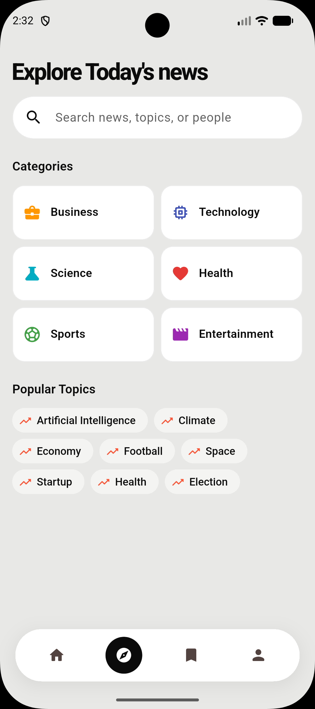
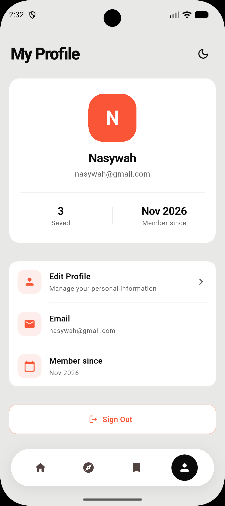

# Today – News App

A clean and modern news application built with Flutter, designed to keep users informed with the latest headlines through a simple and intuitive reading experience.

## ✨ Features

- **User Authentication** – Sign up and log in securely using Firebase Authentication.
- **News Feed** – Browse the latest headlines fetched from a News API.
- **Search News** – Find articles based on specific keywords.
- **News Categories** – Explore news across different categories.
- **Bookmark Articles** – Save your favorite articles and access them later.
- **Profile Management** – View and edit personal profile information.
- **Dark & Light Mode** – Switch between themes for a comfortable reading experience.

## 🛠️ Tech Stack

- **Flutter** – Cross-platform application development.
- **Dart** – Programming language.
- **Riverpod** – State management.
- **Firebase Authentication** – User authentication.
- **News API** – Fetching news articles.
- **Material Design 3** – User interface and theming.

## 📱 Screenshots



[alt text](Screenshot_1794727974.png) 
 

## 🚀 Getting Started

### Prerequisites

Make sure you have installed:
- Flutter SDK
- Dart SDK
- Android Studio or Visual Studio Code

### Installation

1. Clone this repository:

   ```bash
   git clone https://github.com/faihawanda/today-app.git
   ```

2. Navigate to the project directory:

   ```bash
   cd today-app
   ```

3. Install dependencies:

   ```bash
   flutter pub get
   ```

4. Configure your environment variables and Firebase project according to your local setup.

5. Run the application:

   ```bash
   flutter run
   ```

## 👩🏻‍💻 Developer

**Faiha Wanda Nabilah**

- GitHub: [@faihawanda](https://github.com/faihawanda)
- LinkedIn: [Faiha Wanda Nabilah](https://www.linkedin.com/in/faiha-wanda-nabilah/)

---

*Built with Flutter & Dart.*